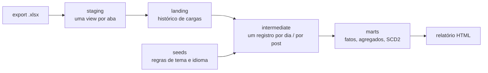

# Arquitetura

Para quem quer entender ou mudar o projeto por dentro. Para usar, o [README](../README.md) basta.

## Fluxo



| Camada | Modelos | Materialização | O que faz |
|---|---|---|---|
| staging | `stg_linkedin__*` | view | Lê o arquivo apontado em `var('linkedin_export')`, uma view por aba (`read_xlsx` do DuckDB). Tipa datas e percentuais. |
| landing | `lnd_linkedin__*` | incremental (`delete+insert` por `export_id`) | Histórico de todas as cargas. Exports já carregados são pulados. `full_refresh: false`: nunca são recriadas. |
| seeds | `topic_rules`, `language_rules` | tabela | Regras de classificação pela URL do post. |
| intermediate | `int_linkedin__daily` | incremental (`merge` por dia) | Um registro por dia, escolhendo entre exports sobrepostos. Numa carga, recalcula só os dias da janela do arquivo. |
| | `int_linkedin__posts`, `int_linkedin__post_classification` | view | Um registro por post, com tema, idioma e formato. |
| marts | `fct_linkedin__daily`, `agg_linkedin__weekly`, `agg_linkedin__monthly` | view | Série diária, semanal e mensal. |
| | `fct_linkedin__posts`, `agg_linkedin__posts_by_dimension`, `mart_linkedin__kpis`, `mart_linkedin__demographics_comparison`, `dim_linkedin__audience_scd2` | tabela | Posts, medianas por tema/idioma/formato, indicadores, público. |
| snapshots | `snap_linkedin__post_classification` | snapshot | SCD2 da classificação dos posts. |

## Seletores

| Seletor | Quando | O que roda |
|---|---|---|
| `transform` (padrão) | `dbt build`, `make report` | Tudo menos staging e landing. Não lê xlsx. |
| `ingest` | `scripts/ingest.sh`, `make load` | Tudo, lendo o arquivo de `var('linkedin_export')`. |

## Como exports se combinam

Cada carga é guardada separada (`export_id` = md5 do conteúdo do arquivo), então a ordem de carga não
importa e recarregar o mesmo arquivo não duplica nada.

| Dado | Regra |
|---|---|
| Diário (impressões, engajamentos, seguidores) | Um valor por dia. Vence o export em que o dia já estava completo (anterior à data do download) e, entre esses, o baixado por último. |
| Posts (top 50) | As métricas do export contam só a janela dele. Fica o maior valor visto entre exports. |
| Posts recentes | Leitura do export baixado por último. |
| Perfil do público, total de seguidores | Uma foto por export. Os marts usam a mais recente; o histórico vira SCD2. |
| Alcance (members reached) | Não pode ser somado entre janelas; fica por export em `lnd_linkedin__exports`. |

"Baixado por último" usa a data de modificação do arquivo. Copiar um export com `cp` sem `-p` muda essa
data; isso só afeta o último dia de cada export, o único incompleto.

Buracos de cobertura: `agg_linkedin__monthly.is_month_fully_covered` e
`mart_linkedin__kpis.days_missing_in_coverage`.

## Dimensões SCD2

| Dimensão | Como | Validade | Nova versão quando |
|---|---|---|---|
| `dim_linkedin__audience_scd2` | Modelo SQL sobre `lnd_linkedin__demographics` | Data do download | O % de um item muda, ou ele sai/volta da lista (`is_present`) |
| `snap_linkedin__post_classification` | `dbt snapshot`, estratégia `check` | Horário da execução | Uma edição nas regras muda tema/idioma/formato de um post |

O público não usa `dbt snapshot` porque o snapshot supõe dados chegando em ordem, e exports podem chegar
fora de ordem. Montado a partir do histórico, o SCD2 independe da ordem e pode ser reconstruído.
A classificação usa snapshot porque as mudanças vêm das suas edições, que acontecem em ordem.
O histórico do snapshot só existe no banco: `make reset` o apaga e os exports não o recriam.

Versão atual: `where is_current` (público) ou `where dbt_valid_to is null` (classificação).

## Variáveis (`dbt_project.yml`)

| Variável | Padrão | Para quê |
|---|---|---|
| `linkedin_export` | vazio | Caminho do .xlsx a carregar. O `ingest.sh` preenche. |
| `force_reload` | `false` | Regrava um export já carregado (ex.: depois de mudar o staging). |
| `low_activity_quantile` | 0.25 | Fração dos dias com menos impressões da conta que conta como "quase sem impressões" (base de seguidores). Relativo ao tamanho da conta. |
| `follower_attribution_days` | automático | Janela para atribuir seguidores a um post (dia do post + seguintes). Automático: metade do intervalo típico entre posts, de 1 a 3 dias. |
| `top_posts_list_limit` | 50 | Tamanho máximo das listas da aba TOP POSTS. Quando uma lista chega nele, o relatório avisa que as análises por post só veem os melhores posts. |

Recarregar um export já carregado:

```bash
.venv/bin/dbt build --profiles-dir . --selector ingest \
  --vars '{linkedin_export: "/caminho/export.xlsx", force_reload: true}'
```

## Testes

- **Unit tests** (`models/_unit_tests.yml`, dados simulados): SCD2 com exports fora de ordem e item que
  some e volta; precedência do diário entre exports sobrepostos.
- **Testes de dados:** unicidade das chaves; taxa de engajamento entre 0 e 1; uma única versão atual,
  sem sobreposição, por item do SCD2; `assert_export_daily_matches_overview` (em cada export, a soma
  diária bate com o total da aba DISCOVERY; se o LinkedIn mudar o layout da planilha, este falha).
- **Frases do relatório** (`tests_py/test_insights.py`, contas simuladas: pequena, grande e estável,
  posta todo dia, histórico curto): toda comparação responde nos dois sentidos ou "sem diferença clara",
  grupos pequenos ficam de fora e listas truncadas geram aviso e suprimem frases de contagem.

## Espaço em disco

`on-run-end` roda `CHECKPOINT`. O DuckDB não devolve ao sistema o espaço de linhas apagadas;
`make compact` copia o banco para um arquivo novo e deixa o antigo como `linkedin.duckdb.bak`.
